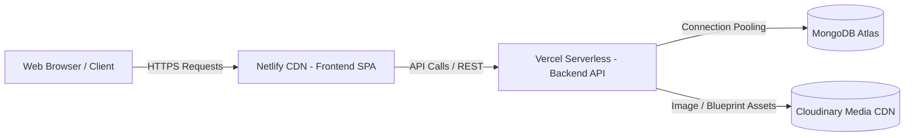

# 🏛️ RK Stone Corporation — Architectural Stone & Monumental Heritage

<div align="center">


### **Direct Jaipur Quarry Sourcing • Master Artisan Hand-Carving • Pan-India Installation**

[](https://react.dev/)
[](https://www.typescriptlang.org/)
[](https://vitejs.dev/)
[](https://tailwindcss.com/)
[](https://nodejs.org/)
[](https://expressjs.com/)
[](https://www.mongodb.com/atlas)
[](https://cloudinary.com/)
[](https://vercel.com/)
[](https://www.netlify.com/)

**Official Website & Architectural Commissioning Portal for RK Stone Corporation, Jaipur, Rajasthan.**

[Live Demo](#-live-deployments) • [Key Features](#-core-features) • [Tech Stack](#-technology-stack) • [Quick Start](#-quick-start--local-development) • [Deployment Guide](#-production-deployment-guide) • [API Docs](#-api-endpoints-reference)

---

</div>

## 📖 Overview

**RK Stone Corporation** brings over 35 years of authentic Rajasthani stone-carving mastery into the digital era. Operating from its flagship workshop in **Jaipur, Rajasthan**, the corporation supplies, carves, and installs monumental handcrafted stone temples (*Mandirs*), heritage haveli facades, 3D CNC stone screens (*Jalis*), decorative courtyard fountains, and royal stone pavilions (*Chhatris*).

This repository is a full-stack production-ready web application comprising:
1. **Public Architectural Portal**: A luxury, bilingual (English & Hindi) showcase featuring an interactive Live Stone Estimator, CAD/Drawing file submission modal, stone sample kit requests, product catalogue with reviews, and smart non-intrusive floating communication channels.
2. **Admin CRM & Master Control Suite**: A password-protected, mobile-responsive enterprise control center to manage product listings, track and triage architectural leads with blueprints, update quarry square-foot pricing in real-time, and customize live site announcements, contact numbers, and hero banners.

---

## ✨ Core Features

### 🏛️ 1. Public Architectural Experience
- **Handcrafted Temple & Mandir Showcase**: Detailed architectural galleries of temple shikhars, carved stambhas (pillars), and garbhagrihas carved in authentic *Bansi Paharpur Pink Stone* and *Makrana White Marble*.
- **Heritage Haveli Facades & Jharokhas**: Traditional Rajasthani brackets, carved balconies, and stone cornices built in *Dholpur Beige* and *Jodhpur Imperial Red Sandstone*.
- **3D CNC Stone Jalis & Architectural Screens**: Parametric and traditional floral stone lattices for ventilation, privacy, and facade aesthetics.
- **Interactive Live Stone Cost Estimator**:
  - Calculates instant project cost estimates based on stone variety, square footage, craft complexity multipliers, wastage factor (8%), and installation surcharges (15%).
  - Real-time bilingual pricing with direct WhatsApp inquiry generation.
- **Client CAD / Blueprint & Photo Dossier Submission**:
  - Direct multi-file upload supporting CAD drawings, PDFs, blueprints, and site photos up to 30MB with cloud CDN storage.
- **Compact Non-Intrusive Floating CTA**:
  - Direct Phone Call & WhatsApp speed-dials positioned gracefully above the Back-to-Top trigger, ensuring zero overlay onto reading content or footers.
- **Bilingual Heritage Support**:
  - English and Hindi product nomenclature, descriptions, and stone classifications.
- **Dynamic SEO & Social Metadata**:
  - Powered by `react-helmet-async`, Open Graph previews, Twitter Cards, canonical tags, and structured JSON-LD schemas.

### 🛡️ 2. Admin CRM & Master Control Suite
- **Enterprise Dashboard Analytics**: Instant metrics on total inventory, open leads, client reviews, and category breakdown.
- **Product Lifecycle Management**:
  - Add, edit, or archive products with multiple images, dimensions, lead times, Hindi titles, and featured flags.
  - One-click **Active / Disabled Toggle** to immediately hide or show items on the live website.
  - Direct high-resolution image upload powered by **Cloudinary CDN**.
- **Architectural Lead & Drawing Dossier**:
  - Filter inquiries by status (`New`, `Contacted`, `In Design`, `Quoted`, `Completed`).
  - View client blueprints, PDFs, and photos with full-screen zoom and direct download.
  - Direct 1-click **WhatsApp Chat** and **Phone Call** action links for immediate sales follow-up.
  - Internal architect notes and status tracking.
- **Live Stone Calculator Rates Manager**:
  - Adjust base per-square-foot quarry rates and craft multiplier factors with zero server restart or code redeployment.
  - One-click *Reset to Factory Defaults* feature.
- **Live Website Customization Studio**:
  - Modify company phone numbers, WhatsApp dispatch numbers, announcement bar text, hero badge, stone strip, and workshop timings on the fly.
- **Security & Authentication**:
  - JWT token authentication with credentials stored and managed directly in MongoDB Atlas.
  - Built-in secure credential change utility.
- **100% Mobile & Tablet Responsive**: Optimized drawer navigation, touch-friendly tables, and responsive popups across all screen dimensions.

---

## 🛠️ Technology Stack

| Layer | Technologies |
|---|---|
| **Frontend Framework** | [React 18](https://react.dev/) + [Vite 7](https://vitejs.dev/) + [TypeScript](https://www.typescriptlang.org/) |
| **Styling & Animation** | [Tailwind CSS 3](https://tailwindcss.com/) + [Framer Motion](https://www.framer.com/motion/) + [Lucide React](https://lucide.dev/) |
| **UI Component Primitives**| [Radix UI](https://www.radix-ui.com/) + [Sonner Toast](https://sonner.emilkowal.ski/) + [TanStack Query](https://tanstack.com/query) |
| **SEO & Meta** | [React Helmet Async](https://github.com/staylor/react-helmet-async) + Dynamic XML Sitemaps |
| **Backend Runtime** | [Node.js](https://nodejs.org/) (ES6+ / CommonJS) + [Express.js 4](https://expressjs.com/) |
| **Database & ORM** | [MongoDB Atlas](https://www.mongodb.com/atlas) + [Mongoose 8](https://mongoosejs.com/) |
| **Media CDN Storage** | [Cloudinary](https://cloudinary.com/) (Multer Cloudinary Storage) |
| **Authentication & Mail** | [JSON Web Tokens (JWT)](https://jwt.io/) + [Nodemailer](https://nodemailer.com/) (Gmail SMTP) |
| **Serverless Deployment** | [Vercel](https://vercel.com/) (Backend Serverless Functions) |
| **Static Web Deployment** | [Netlify](https://www.netlify.com/) (Frontend CDN with SPA Rewrite Routing) |

---

## 📁 Repository Structure

```text
RK Stone Corporation/
│
├── frontend/                          # Client Web Application (Vite + React + TS)
│   ├── public/
│   │   ├── _redirects                 # Netlify SPA redirect rules (/* /index.html 200)
│   │   ├── favicon.png                # Brand favicon
│   │   ├── robots.txt                 # Search engine crawler directives
│   │   └── sitemap.xml                # SEO sitemap index
│   ├── src/
│   │   ├── assets/                    # Static brand logos & background textures
│   │   ├── components/                # Modular React components
│   │   │   ├── home/                  # StoneCalculator, WorkshopShowcase, DrawingUploadModal
│   │   │   ├── ui/                    # Radix & Tailwind design system primitives
│   │   │   ├── Navigation.tsx         # Header navigation bar with mobile drawer
│   │   │   ├── Footer.tsx             # Interactive footer with moving animations
│   │   │   ├── MobileStickyCTA.tsx    # Compact floating phone & WhatsApp speed-dials
│   │   │   ├── BackToTop.tsx          # Smooth window scroll-to-top trigger
│   │   │   └── Seo.tsx                # Meta tags, OpenGraph, JSON-LD schemas
│   │   ├── config/
│   │   │   └── api.ts                 # Dynamic API base URL configuration (VITE_API_URL)
│   │   ├── pages/                     # Routed application views
│   │   │   ├── Index.tsx              # Home landing page with all interactive modules
│   │   │   ├── StoneTempleJaipur.tsx  # Temple & Mandir showcase
│   │   │   ├── HeritageHavelis.tsx    # Haveli facade & jharokhas page
│   │   │   ├── CncJaliJaipur.tsx      # 3D CNC Stone Jali showcase
│   │   │   ├── CourtyardArtifacts.tsx # Courtyard fountains & planters
│   │   │   ├── Shop.tsx               # Product catalogue with category & search filters
│   │   │   ├── ProductDetail.tsx      # Deep product specifications & reviews
│   │   │   ├── Materials.tsx          # Quarry varieties & technical stone specs
│   │   │   ├── Portfolio.tsx          # Landmark monuments gallery
│   │   │   ├── Architects.tsx         # Architect & Designer B2B collaboration
│   │   │   ├── About.tsx              # Heritage, lineage & craftsmanship story
│   │   │   ├── Contact.tsx            # Inquiry form with file uploads & map embed
│   │   │   ├── AdminLogin.tsx         # Secure admin login screen
│   │   │   ├── AdminProducts.tsx      # Master Admin CRM, Leads, Products & Rates
│   │   │   └── NotFound.tsx           # Luxury 404 stone-themed error page
│   │   ├── App.tsx                    # Route definitions & Query Client provider
│   │   ├── index.css                  # Global styles, Tailwind directives & animations
│   │   └── main.tsx                   # React DOM root entry point
│   ├── netlify.toml                   # Netlify build configuration & SPA rewrites
│   ├── package.json                   # Frontend dependencies & npm scripts
│   ├── tailwind.config.ts             # Custom colors (sandstone, heritage gold) & typography
│   └── vite.config.ts                 # Vite bundler plugins & alias mappings
│
├── backend/                           # API Server (Express + MongoDB + Serverless)
│   ├── uploads/                       # Fallback local directory for attachments
│   ├── .env.example                   # Backend environment template
│   ├── package.json                   # Backend dependencies & scripts
│   ├── seedCatalog.js                 # Initial architectural stone products seed script
│   ├── server.js                      # Express application, routes, models & pooling
│   └── vercel.json                    # Vercel serverless build and routing configuration
│
└── README.md                          # Comprehensive project documentation
```

---

## 🚀 Quick Start & Local Development

### 1. Prerequisites
- **Node.js**: v18.0.0 or higher
- **npm**: v9.0.0 or higher
- **MongoDB Atlas**: A free cluster or local MongoDB instance
- **Cloudinary Account**: Free tier cloud for image hosting

### 2. Clone the Repository
```bash
git clone https://github.com/amitchauhan004/RK-Strone-Corporation.git
cd RK-Strone-Corporation
```

---

### 3. Backend Setup
1. Navigate into the `backend` folder:
   ```bash
   cd backend
   ```
2. Install dependencies:
   ```bash
   npm install
   ```
3. Create a `.env` file from the template:
   ```bash
   cp .env.example .env
   ```
4. Configure your `.env` variables:
   ```env
   PORT=5000
   MONGODB_URI=mongodb+srv://<user>:<password>@cluster.mongodb.net/rkstonedb?retryWrites=true&w=majority
   ADMIN_USERNAME=admin
   ADMIN_PASSWORD=admin123
   AUTH_SECRET=your_jwt_secret_key_here
   
   # Cloudinary (Media Hosting)
   CLOUDINARY_CLOUD_NAME=your_cloudinary_name
   CLOUDINARY_API_KEY=your_cloudinary_api_key
   CLOUDINARY_API_SECRET=your_cloudinary_api_secret

   # Gmail SMTP for Lead Notifications (Optional)
   GMAIL_ID=your_email@gmail.com
   GMAIL_APP_PASSWORD=your_gmail_app_password
   ```
5. *(Optional)* Seed initial architectural products into your database:
   ```bash
   node seedCatalog.js
   ```
6. Start the backend development server:
   ```bash
   npm start
   ```
   *The server will run on `http://localhost:5000`.*

---

### 4. Frontend Setup
1. Open a new terminal and navigate to the `frontend` folder:
   ```bash
   cd ../frontend
   ```
2. Install dependencies:
   ```bash
   npm install
   ```
3. Create a `.env` file:
   ```bash
   cp .env.example .env
   ```
4. Verify `frontend/.env` points to your local backend:
   ```env
   VITE_API_URL=http://localhost:5000
   ```
5. Start the frontend development server:
   ```bash
   npm run dev
   ```
   *The web app will launch at `http://localhost:8080` (or `http://localhost:5173`).*

---

## ⚙️ Environment Variables Reference

### Backend (`backend/.env`)
| Variable | Description | Example / Default |
|---|---|---|
| `PORT` | Local HTTP Port | `5000` |
| `MONGODB_URI` | MongoDB Atlas Connection String | `mongodb+srv://...` |
| `ADMIN_USERNAME` | Initial Admin Username (seeded on first run) | `admin` |
| `ADMIN_PASSWORD` | Initial Admin Password | `admin123` |
| `AUTH_SECRET` | Secret key for JWT generation | `long_random_jwt_secret` |
| `CLOUDINARY_CLOUD_NAME` | Cloudinary account cloud name | `your_cloud_name` |
| `CLOUDINARY_API_KEY` | Cloudinary API Key | `1234567890` |
| `CLOUDINARY_API_SECRET` | Cloudinary API Secret | `your_secret` |
| `GMAIL_ID` | Gmail address for sending inquiry alerts | `contact@rkstone.com` |
| `GMAIL_APP_PASSWORD` | 16-character Google App Password | `abcd efgh ijkl mnop` |

### Frontend (`frontend/.env`)
| Variable | Description | Production Example |
|---|---|---|
| `VITE_API_URL` | Base URL of the deployed Express backend | `https://rk-stone-backend.vercel.app` |

---

## 🌐 Production Deployment Guide

The architecture separates the **Backend (Vercel Serverless)** from the **Frontend (Netlify Global Edge CDN)** for optimal performance, low latency, and zero cold-start database timeouts.



### 1. Deploy Backend to Vercel
1. Log in to your [Vercel Dashboard](https://vercel.com/) and click **"Add New Project"**.
2. Connect your GitHub repository: `amitchauhan004/RK-Strone-Corporation`.
3. In the project settings:
   - **Framework Preset**: *Other*
   - **Root Directory**: Click edit and choose `backend`.
4. In the **Environment Variables** section, add:
   - `MONGODB_URI`
   - `ADMIN_USERNAME`
   - `ADMIN_PASSWORD`
   - `AUTH_SECRET`
   - `CLOUDINARY_CLOUD_NAME`
   - `CLOUDINARY_API_KEY`
   - `CLOUDINARY_API_SECRET`
   - `GMAIL_ID`
   - `GMAIL_APP_PASSWORD`
5. Click **Deploy**.
6. When deployment finishes, copy your backend URL (e.g., `https://your-backend.vercel.app`).
7. Verify by opening `https://your-backend.vercel.app/` in your browser; it should display:
   ```text
   RK Stone Corporation API is running
   ```

### 2. Deploy Frontend to Netlify
1. Log in to your [Netlify Dashboard](https://app.netlify.com/) and click **"Add new site" > "Import an existing project"**.
2. Select **GitHub** and grant access to `amitchauhan004/RK-Strone-Corporation`.
3. Configure the build settings:
   - **Base directory**: `frontend`
   - **Build command**: `npm run build`
   - **Publish directory**: `frontend/dist` (or `dist`)
4. In the **Environment variables** section, add:
   - `VITE_API_URL` = `https://your-backend.vercel.app` *(The Vercel backend URL from step 1)*
5. Click **Deploy site**.
6. Netlify will build the Vite bundle and deploy it with full SPA routing support (via `netlify.toml` and `public/_redirects`).

---

## 📡 API Endpoints Reference

### Public Endpoints
| Method | Endpoint | Description |
|---|---|---|
| `GET` | `/` | Health check route |
| `GET` | `/api/products` | Retrieve active products (supports `category` and `search` query parameters) |
| `GET` | `/api/products/:id` | Fetch single product by MongoDB ID, unique product code, or slug |
| `GET` | `/api/products/:id/reviews` | Fetch client reviews for a specific product |
| `POST` | `/api/products/:id/reviews` | Submit a client review with rating and comment |
| `POST` | `/api/contact` | Submit client inquiry / project quotation lead |
| `POST` | `/api/upload-attachment` | Upload CAD drawings, PDFs, or photos (up to 10 files, 30MB each) |
| `GET` | `/api/calculator-rates` | Fetch current stone base square-foot prices and craft factors |
| `GET` | `/api/site-settings` | Fetch live announcement banner, phone numbers, and workshop timings |

### Admin Endpoints (Secured)
| Method | Endpoint | Description |
|---|---|---|
| `POST` | `/api/admin/login` | Admin authentication returning 24h JWT token |
| `GET` | `/api/admin/credentials` | Fetch current admin user role & metadata |
| `PUT` | `/api/admin/change-credentials` | Update admin username and password directly in MongoDB Atlas |
| `GET` | `/api/admin/stats` | Analytics metrics (total products, open leads, reviews count) |
| `POST` | `/api/upload` | Upload high-resolution product image to Cloudinary |
| `POST` | `/api/products` | Add new product to catalogue |
| `PUT` | `/api/products/:id` | Update existing product specs, dimensions, or images |
| `PATCH` | `/api/products/:id/toggle-status` | Toggle product active (live) / disabled (hidden) state |
| `DELETE` | `/api/products/:id` | Permanently delete a product |
| `GET` | `/api/inquiries` | Retrieve all incoming client leads and drawing attachments |
| `PUT` | `/api/inquiries/:id` | Update lead status (`New` ➔ `Quoted` ➔ `Completed`) and add notes |
| `DELETE` | `/api/inquiries/:id` | Delete an inquiry lead |
| `GET` | `/api/admin/reviews` | Moderate all website reviews |
| `DELETE` | `/api/admin/reviews/:id` | Remove a review |
| `PUT` | `/api/admin/calculator-rates` | Update live stone rates and multiplier factors |
| `POST` | `/api/admin/calculator-rates/reset`| Reset stone estimator pricing to factory rates |
| `PUT` | `/api/admin/site-settings` | Update live announcement text, phone, WhatsApp, and hero strip |
| `POST` | `/api/admin/site-settings/reset` | Reset site settings to default factory values |

---

## 🪨 Heritage Stones & Materials Handled

| Stone Variety | Origin / Quarry | Primary Architectural Applications | Base Rate / Sq.Ft |
|---|---|---|---|
| **Gwalior White Mint** | Madhya Pradesh | Delicate 3D CNC Jalis, indoor screen partitions, decorative wall reliefs | ₹450 / sq.ft |
| **Dholpur Beige / Pink** | Dholpur, Rajasthan | Classical Haveli facades, fluted pillars, ornamental jharokhas & brackets | ₹480 / sq.ft |
| **Bansi Paharpur Pink** | Bharatpur, Rajasthan | Monumental temple spires (*Shikhars*), sanctum sanctorums, idol shrines | ₹650 / sq.ft |
| **Jodhpur Imperial Red** | Jodhpur, Rajasthan | Heavy load-bearing columns, monumental fort entrance gates, steps | ₹520 / sq.ft |
| **Makrana Pure White Marble** | Makrana, Rajasthan | Pure calcite sanctums, deity pedestals, royal water fountains | ₹1,250 / sq.ft |

---

## 🏭 Workshop & Manufacturer Contact

**RK Stone Corporation** welcomes architects, interior designers, temple trusts, and heritage conservators to inspect carving workshops and raw quarry stone slabs directly in Jaipur.

- 📍 **Workshop Address**: Front of Surya City, Paldi Meena, Agra Road, Jaipur 302031, Rajasthan, India
- 📞 **Direct Phone**: [+91 94147 84562](tel:+919414784562)
- 💬 **WhatsApp Hotline**: [+91 94147 84562](https://wa.me/919414784562)
- ✉️ **Official Email**: [contact@rkstonecorporation.com](mailto:contact@rkstonecorporation.com)
- 🌐 **Google Maps Location**: [R K Stone Corporation, Jaipur](https://maps.google.com/?cid=14423985551390461865)
- 📜 **GSTIN**: `08AAAAA0000A1Z5`
- ⏰ **Workshop Visiting Hours**: Monday – Sunday: 8:00 AM – 7:00 PM IST

---

## 📄 License & Attribution

This project is licensed under the [MIT License](LICENSE).  
Copyright © 2024–2026 **RK Stone Corporation**. Handcrafted with pride in Jaipur, Rajasthan, India.
